# Chief Auto playtest, 2026-10-16

Agent: `claude-faisallaptop` (Claude 2, laptop). One windowed run, no game code changed.

**How:** Godot 4.3-stable (already installed at `C:\Users\faisa\Tools\Godot_4.3`; nothing new installed). Headless `--import` first, then the repo's own tour `tests/_tour_shot.tscn` in a real 1280x720 window with `--print-fps`. The tour loads a mid-game state (level 6, $180,000, 5 cars) and opens each screen in turn. `tests/smoke_test.gd` also passes. Laptop: RTX 5080 Laptop GPU, shared with Roblox Studio and Unity sessions during the run.

**Result:** no crashes or script errors, and every area loads with its art. Steady 60 FPS (V-Sync cap) once a screen is open.

## Findings

| # | Area | What | Severity |
|---|---|---|---|
| 1 | Lot, Garage | Entering the lot and the garage the first time freezes the game for about 1 to 3 seconds (FPS logged 1, 1, 3, 15 on the lot and 14, 1, 1 on the garage). Other screens dip only to 37 to 55 FPS for a moment. Likely 3D scenes and shaders compiling on first view. The other engines on the laptop may make it worse. | Medium |
| 2 | Garage | Two "walked into the showroom" toasts cover the "VEHICLE INSPECTION" title and the status/history line. The 3D car sits on a plain black box instead of a backdrop. ([04](04_garage.jpg)) | Low |
| 3 | Showroom (both tiers) | The Showroom Activity panel covers the leftmost car's price tag (2019 Subaro Outbuck, $40,000). ([05](05_showroom.jpg), [16](16_showroom_flagship.jpg)) | Low |
| 4 | Showroom (both tiers) | The Mazdo price tag covers a wall sign whose red second line looks like "NEWPORT BEACH" rather than "TEWPORT BEACH". Too small to read for sure; needs a closer look. | Low, unconfirmed |
| 5 | Showroom flagship | At dealership 3 (Harbour Flagship) the showroom looks exactly like the Corner Lot showroom. The lot exterior does change. Could be by design. ([16](16_showroom_flagship.jpg) vs [05](05_showroom.jpg)) | Question |
| 6 | Marco | Marco's 3D model is framed from the chin down, so his head is cut off. Toasts also cover the "STATUS & STATS" header. ([06](06_marco.jpg)) | Low |
| 7 | Staff | Jeff's portrait has a dark band across his hair, which looks like a gap in the hair mesh. ([07](07_staff.jpg)) | Low |
| 8 | Office PC | The bezel brand under the monitor is blurry and reads oddly ("TEWATRON"?). The browser window width changes from tab to tab (about 1090 to 1194 px), so the frame jumps when you switch tabs. | Low |
| 9 | Home, Lot, Garage, Showroom | The HUD showed Level 1 / $15,000 on these screens and only updated to Level 6 / $180,000 on Marco's screen. This may be the tour setting values directly, not a game bug. | Unconfirmed |
| 10 | Import | The known shader-compiler error still appears on import and in the smoke test (`custom_samplers.has(...tex_builtin)`, `shader_compiler.cpp:1283`). There is also one `NavigationServer ... before first map synchronization` error during the tour. | Low |

Not tested: real mouse and keyboard input (the tour calls `show_screen` directly), the title > Start > intro flow, the sales minigame, paperwork, a full day end, and the Web/Windows exports.

## Screenshots

| | |
|---|---|
| 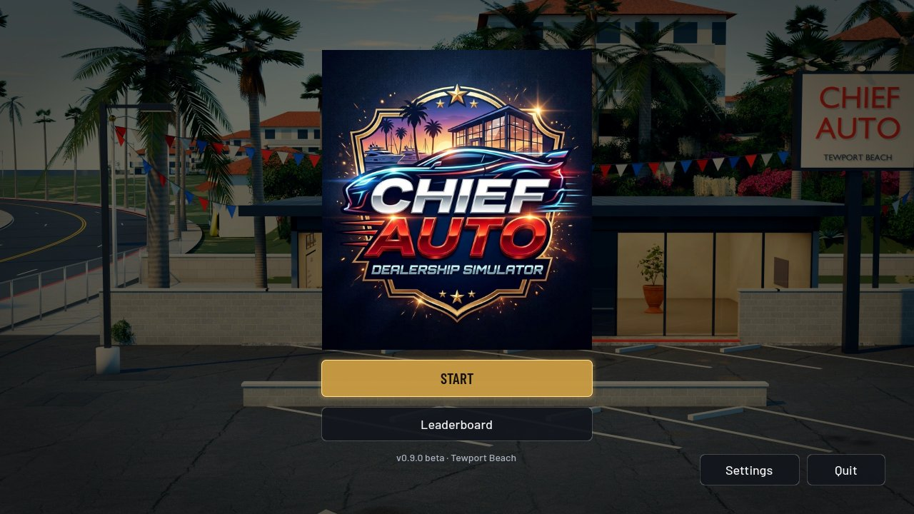 Title | 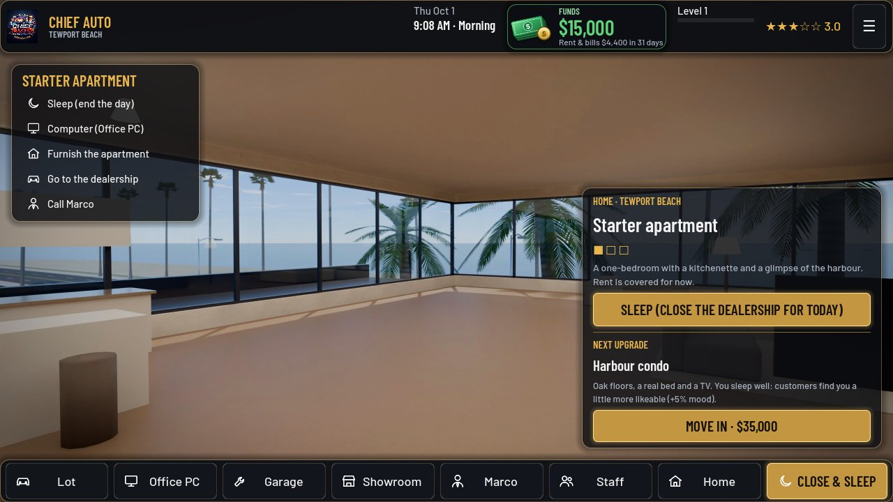 Home |
| 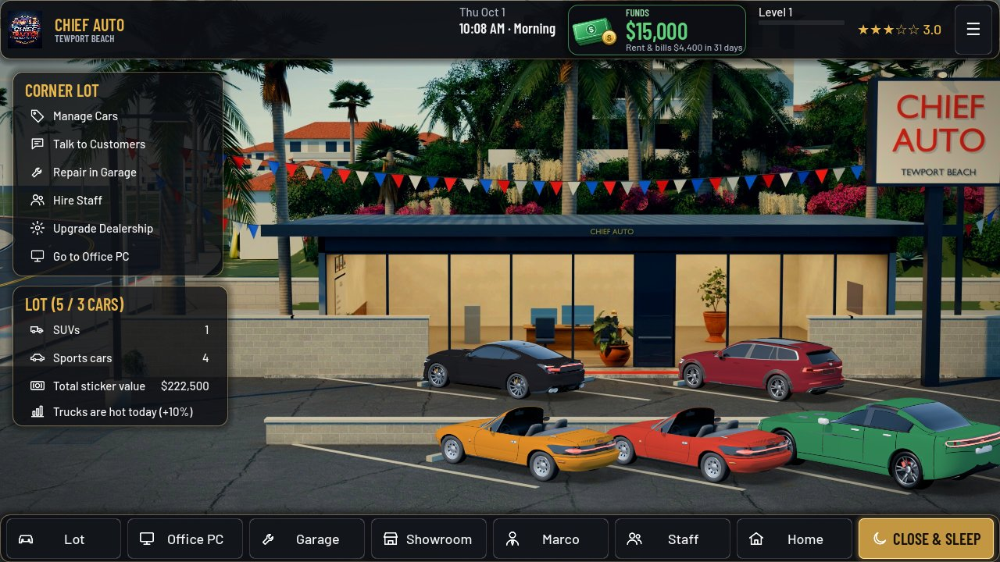 Lot | 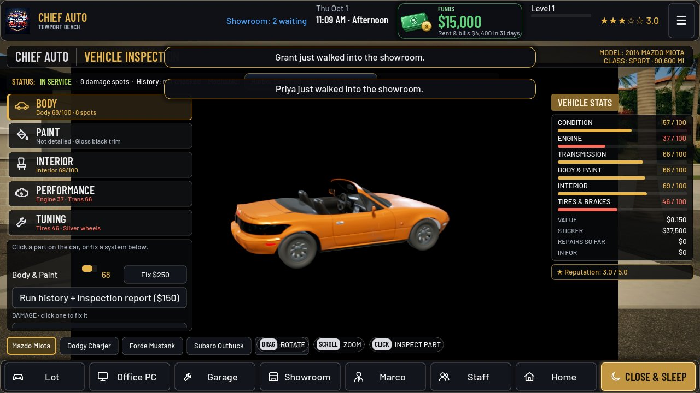 Garage |
| 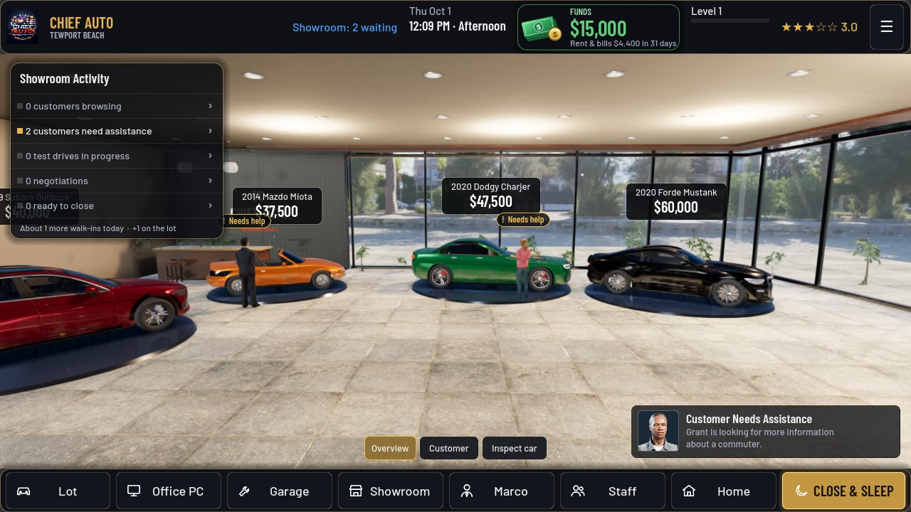 Showroom | 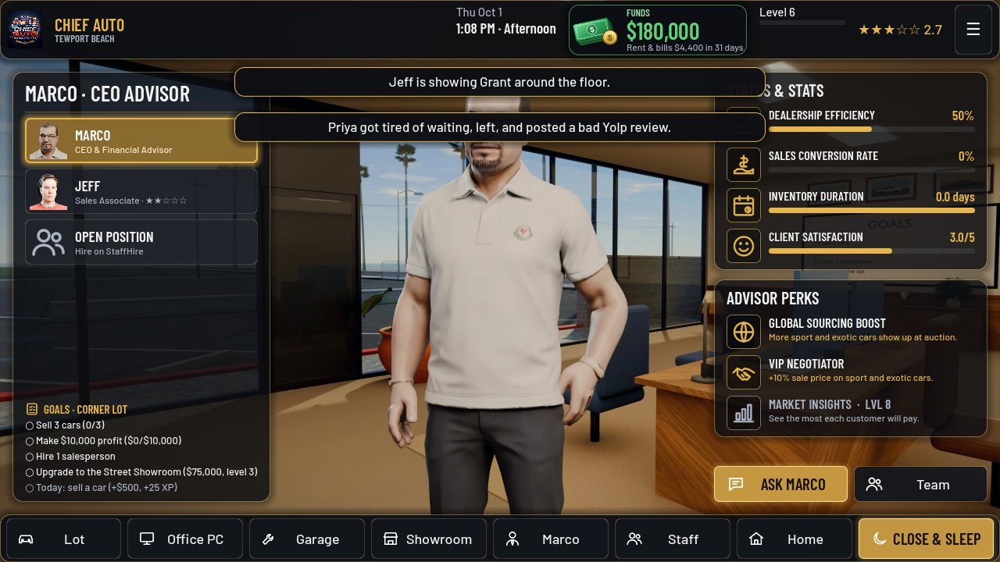 Marco |
| 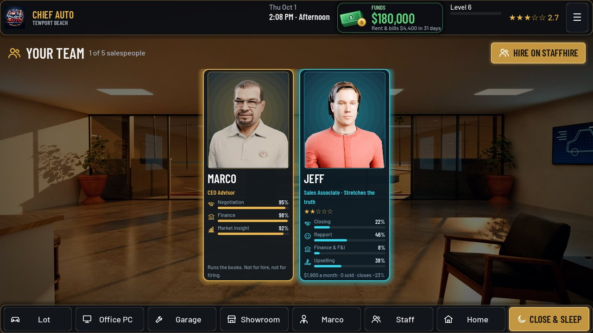 Staff | 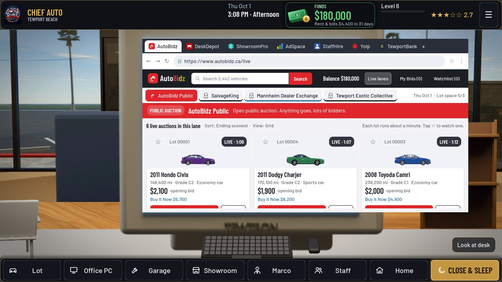 PC: AutoBidz |
| 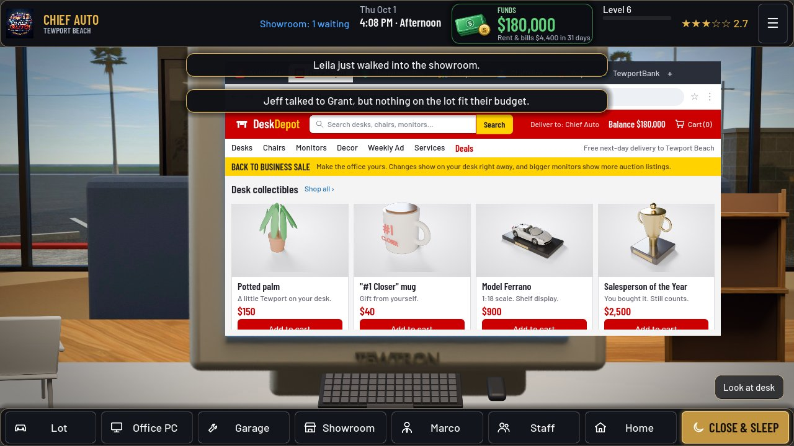 PC: DeskDepot | 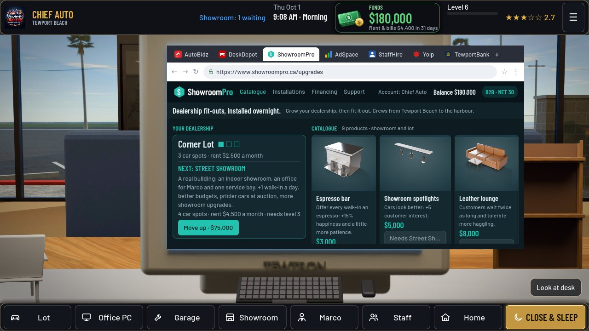 PC: ShowroomPro |
| 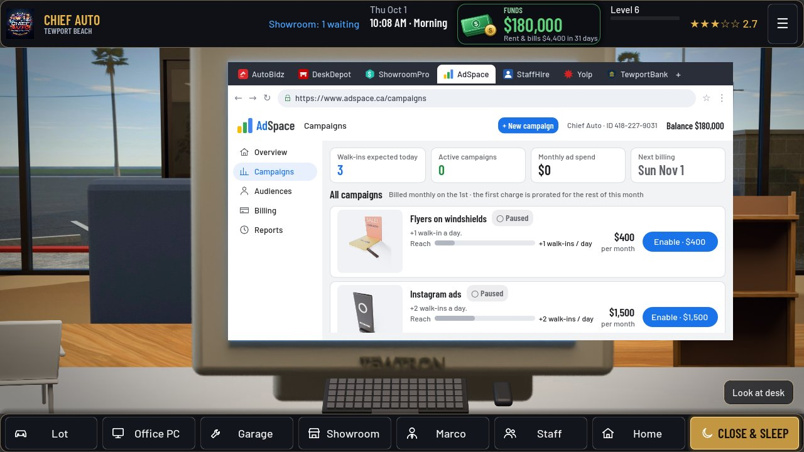 PC: AdSpace | 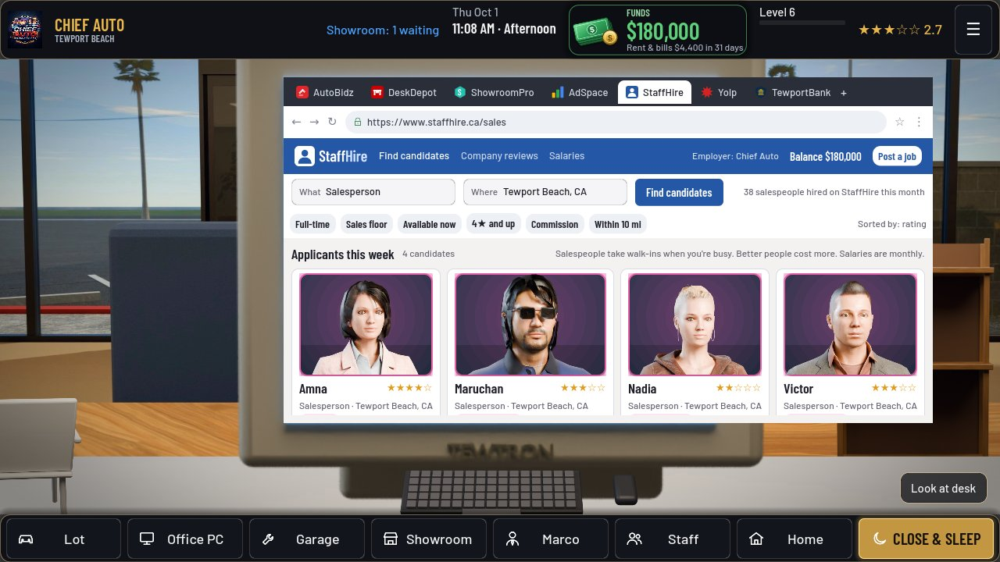 PC: StaffHire |
| 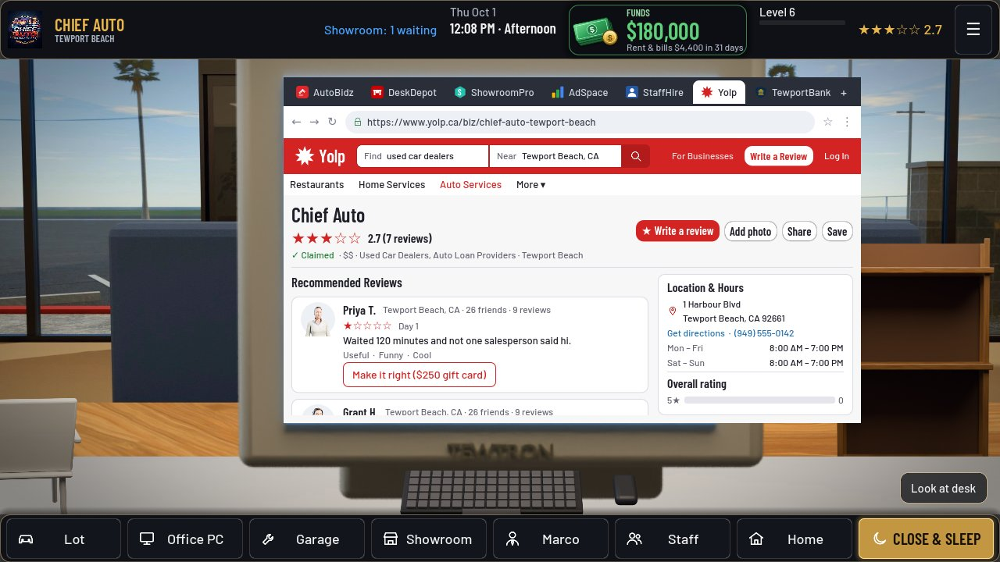 PC: Yolp | 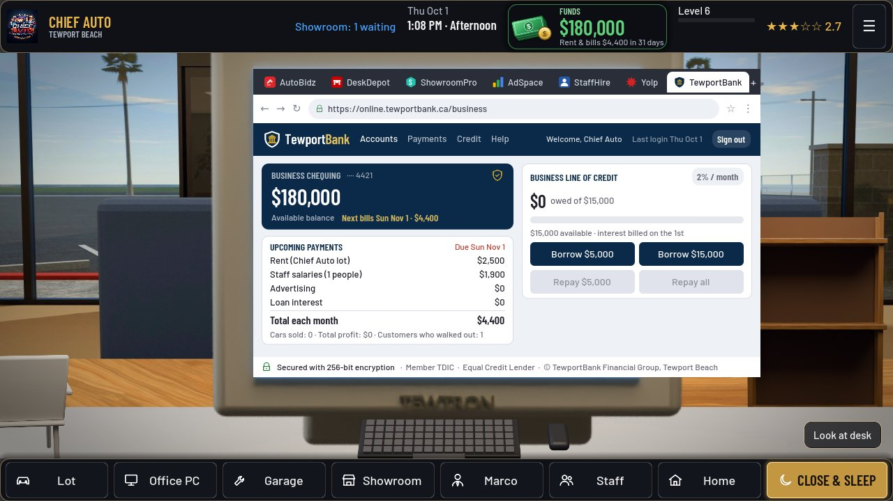 PC: TewportBank |
| 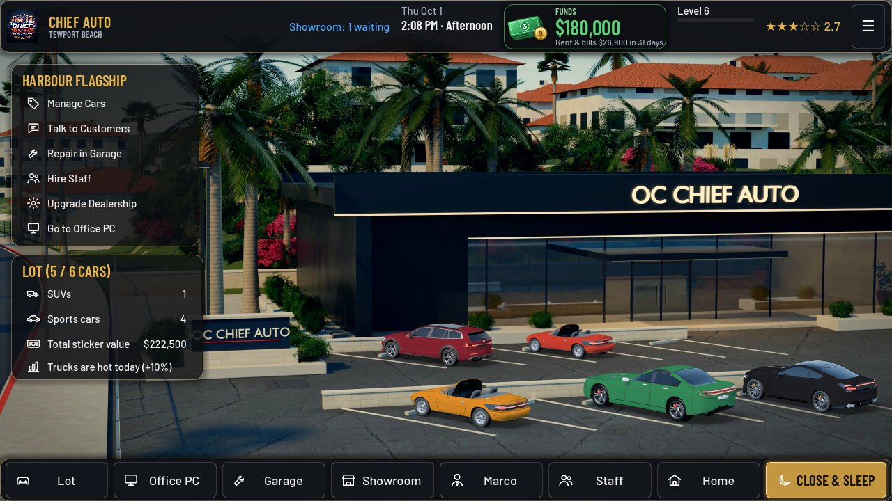 Lot (flagship) | 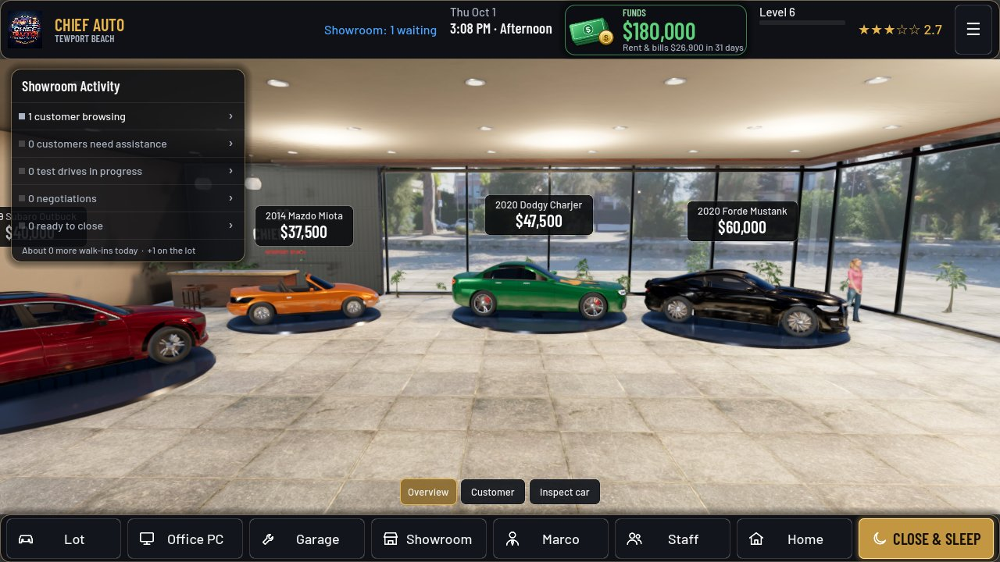 Showroom (flagship) |
